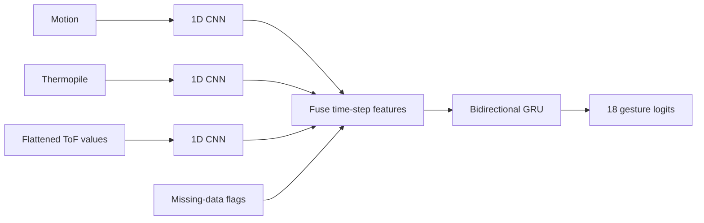
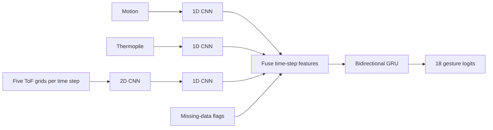
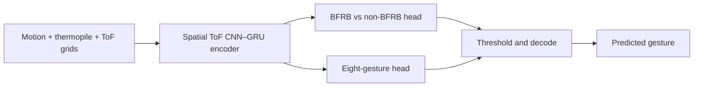
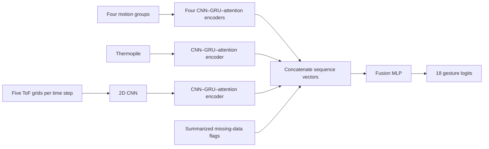

# SC4000 Group Assignment

## Models

All four models take a padded sensor sequence and a mask marking its real time steps. The prepared input has 346 features per time step: 16 motion features, 5 thermopile readings, 320 time-of-flight (ToF) values, and 5 missing-data flags. These are full-sensor models; an IMU-only student is not included here yet.

### 1. Baseline — [model/baseline.py](model/baseline.py)

`FullSensorCNNGRU` uses a separate 1D CNN for motion, thermopile, and ToF readings. It treats the 320 ToF values as a flat feature vector at each time step. The three CNN outputs and missing-data flags are combined, then one bidirectional GRU summarizes the sequence for an 18-gesture prediction.

### 2. Spatial ToF CNN–GRU — [model/tof_cnn_gru.py](model/tof_cnn_gru.py)

`FullSensorToFCNNGRU` keeps the baseline's motion and thermopile branches. Its ToF branch first reshapes each time step into five 8×8 grids and uses a 2D CNN to capture spatial patterns. A 1D CNN then processes those features over time. The branches are fused before a shared bidirectional GRU and 18-gesture classifier.

### 3. Two-head spatial ToF CNN–GRU — [model/tof_cnn_gru_two_head.py](model/tof_cnn_gru_two_head.py)

`FullSensorToFTwoHeadCNNGRU` reuses the spatial ToF CNN–GRU encoder but replaces the 18-class classifier with two heads. One predicts whether the gesture is BFRB-like; the other chooses among the eight BFRB gestures. The gesture head is trained only on BFRB examples. At inference, a binary threshold decides whether to output a BFRB gesture or a non-target label.

### 4. Grouped CNN–GRU–attention — [model/grouped_cnn_gru_attention.py](model/grouped_cnn_gru_attention.py)

`FullSensorGroupedCNNGRUAttention` splits motion into acceleration, rotation, linear acceleration, and angular velocity groups. Each group, and the thermopile readings, has its own residual 1D CNN, bidirectional GRU, and attention pooling. The ToF grids pass through a 2D CNN before their own temporal encoder. The resulting sequence-level vectors and summarized missing-data flags are concatenated and passed through an MLP for an 18-gesture prediction.

